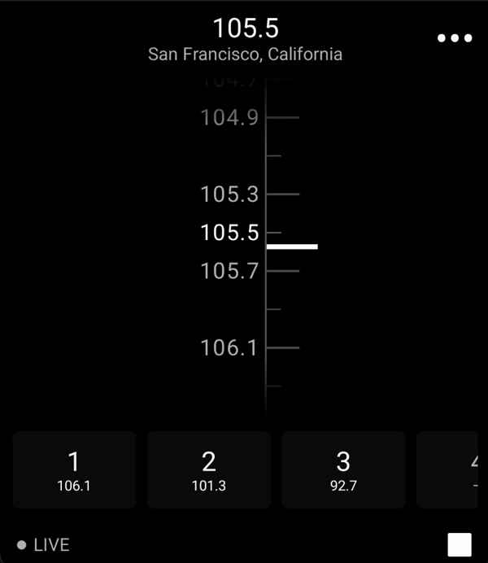

# LightFM

An FM radio for the Light Phone III. Tune stations with the hardware dimmer, set local stations with six memory presets.

## License

LightFM's original source code is licensed under the Apache License, Version 2.0.
See [LICENSE](LICENSE) and [NOTICE](NOTICE). This license does not grant rights to
third-party SDKs, station streams, or third-party data and other content; see
[Data sources](#data-sources-three-layers-joined-by-call-sign) for the bundled station data.

A tool can't be built standalone — the SDK's Gradle plugin generates the manifest and
enforces its API allowlist. Sources live here and are copied into a clone of
[`lightphone/light-sdk`](https://github.com/lightphone/light-sdk)'s `tool/` module to build
(same pattern as L-Message).

## Layout

- `tool/src/main/kotlin/com/lightfm/radio/` — the Kotlin/Compose tool (one screen).
- `tool/lighttool.toml` — the tool manifest (`INTERNET` permission + the `detached-audio` capability).
- `install-into-sdk.sh` — copies LightFM into an SDK clone's `:tool` module. It replaces only
  LightFM's `com/lightfm/radio` source package and overlays bundled assets; other Kotlin packages
  and assets in the SDK clone are left intact. It still overwrites `tool/lighttool.toml` and applies
  the documented HLS dependency patch below.

## Build & run

Prereqs (one-time):

- A clone of `lightphone/light-sdk` (default expected at `./.context/light-sdk`, or pass a path).
- JDK 17 + Android SDK (platform 36). The SDK's `./gradlew` wrapper handles Gradle 9.
- A GitHub Packages PAT with `read:packages` in the SDK clone's `local.properties`:
  ```
  gpr.user=<github-username>
  gpr.key=ghp_<token>
  ```
  (the SDK pulls `light-keyboard` from GitHub Packages.)

The SDK's `:tool` module already applies the serialization + KSP plugins and depends on
`:sdk:client`, so Ktor / kotlinx-serialization / DataStore / Media3 come transitively. HLS playback
needs one additional Media3 module, which the installer adds to the local SDK clone's
`tool/build.gradle.kts`.

> **SDK patch — HLS:** the SDK's media3 setup omits the HLS module, so any `.m3u8` stream (many radio streams,
>    incl. ~170 of the bundled ones) crashes ExoPlayer with `ClassNotFoundException`. It adds
>    `androidx.media3:media3-exoplayer-hls` (matching the SDK's media3 version) to `tool/build.gradle.kts`
>    (marker `// LightFM-hls`). The app also guards at runtime, treating DASH/SmoothStreaming/`.pls`/`.m3u`
>    URLs as "no stream" (static) rather than crashing.
>
> Screen-off playback is no longer a patch — it's the SDK's supported **`detached-audio`** capability
> (`capabilities = ["detached-audio"]` in lighttool.toml + a `LightAudioPlayback.Detached` player), which
> runs a foreground `MediaSessionService`. The old `WAKE_LOCK`/wake-mode hack was removed when we bumped the
> SDK to the version that added detached audio.
>
> Re-running the installer is safe (the patch no-ops if already present).

Emulator (default; `lighttool.toml` ships with `serverPackage = "com.thelightphone.sdk.emulator"`):

```sh
./install-into-sdk.sh ~/path/to/light-sdk
cd ~/path/to/light-sdk && ./gradlew :tool:installDebug
# open "LightFM" in the LightOS emulator (Settings → Allowed Tools → "Built with SDK")
adb logcat | grep -iE "LightFM|ExoPlayer|Media"
```

Real Light Phone III — set `serverPackage = "com.lightos"` in `tool/lighttool.toml` first, then:

```sh
adb devices        # confirm the LP3 is attached
./install-into-sdk.sh ~/path/to/light-sdk
cd ~/path/to/light-sdk && ./gradlew :tool:installDebug
```

## Controls

- **Dial = the real FM band (88.1–107.9).** Every licensed station in range sits at its **true
  frequency** (from the bundled FCC table) — e.g. 94.9 = Wild 94.9, 106.1 = KMEL, 88.5 = KQED. Big
  commercial + public/college stations play (● LIVE); a station with no known stream shows its call
  sign and plays **static** ("no stream"); empty frequencies are static too. Stations we can't stream
  are **dimmed** on the dial so the ones that actually play stand out at a glance. Turn the dimmer wheel
  (317/318) or swipe to browse; tapping a channel (or pressing the wheel, 319) plays it. It starts
  **stopped** and stopping fully ends the stream (no data use when you're not listening). The
  **header** (centered, L-Message two-line style) shows the tuned **frequency** big on top and
  **station name · city** below — both flipping live as you scroll. Tap it to change location.
- **Play / stop:** a permanent **bottom bar** shows the current status on the left and a play/stop
  button on the right (also the wheel press, 319) that starts or fully stops the stream — so it isn't
  streaming when you're not listening.
- **Volume:** LightFM has no separate media-volume control. The device's hardware volume keys adjust
  ringer volume, not LightFM playback.
- **⋯ (top-right) → options half-sheet:** *Snap to stations* (Light UI toggle, persisted) — a **fling/
  swipe** settles on the nearest station that actually streams, skipping call-sign-only/static channels;
  the **wheel** always steps channel-by-channel (through the empties) so you can glide to any frequency; *Wheel
  tunes the dial* (persisted, on by default) — turn it off and the dimmer wheel's turns fall back to
  LightOS (screen brightness) instead of tuning (the wheel *press* still plays/stops); plus *Set
  location* (shows your current city).
- **Tap the title (location)** → embedded-keyboard search with **city or US ZIP autocomplete**;
  pick a result to retune that market.
- **Presets (horizontally-scrolling row of filled tiles)** — L-Message-avatar-style tiles with a subtle
  dark-gray fill, landscape, ~3.5 show at once (the 4th is cropped as the scroll affordance); the playing
  one brightens to white. Tap a saved preset to recall + play (jumps the dial to its frequency);
  **hold** any slot to save the tuned station into it; **keep holding** (a *"Keep holding to remove."*
  hint appears) to clear it. Starts with 6 blank slots; once all are filled a plain **"+"** (no
  background) appends the tuned station as a new slot (grows past 6). Persisted (DataStore).

## Data sources (three layers, joined by call sign)

1. **Dial — FCC** FM facility database (public domain). Bundled `tool/src/main/assets/fcc_fm.csv`
   (~14.4k licensed US FM + LPFM: `call,freq,lat,lon`). Runtime keeps stations within ~90 km, one per
   channel (nearest wins) → the real frequencies + call signs.
2. **Commercial streams — `iheart_streams.txt`** (`CALL\turl\tname`, ~3k entries). Resolved offline
   from broadcaster catalogs; covers the big brands (Wild 94.9, KMEL, KOIT, Live 105, KBLX, 99.7 NOW,
   KFOX…) as their own public HTTPS simulcast URLs (revma/StreamTheWorld/Amperwave). Preferred stream
   when present; shows the brand name.
2b. **Public radio — `npr_streams.txt`** (~994 `CALL\turl\tname`), resolved offline from NPR's Station
   Finder API (`station.api.npr.org/v3`, enumerate orgIds). All HTTPS, exact call-sign+frequency match.
2c. **radio.garden — `radiogarden_streams.txt`** (~1.2k net-new), the **local/community long tail**
   (LPFM, college, ethnic, small-market) our commercial + public-flagship sources miss — e.g. KPOO,
   KALX, KPFA, KDFC. Built offline from radio.garden's place/channel API (`radio.garden/api/ara/…`),
   keeping titles with an FM freq + FCC call sign and resolving each `listen/{id}` 302 to the station's
   **own** direct HTTPS stream (streamguys/berkeley.edu/…). Lowest precedence.
   The five stream layers are merged into one call-sign→stream map (precedence radio.garden < Triton <
   NPR < Audacy < iHeart), checked before Radio Browser.
2d. **Manual pins — `manual_streams.txt`** (`CALL\turl\tname`), hand-verified stream URLs merged at the
   **top** precedence — always win. For the long-tail LPFMs in no directory: find the station's own
   HTTPS stream (its site's player / a directory) and add a row. E.g. `KEXC` (SF 92.7 = a KEXP Bay Area
   relay) → `https://kexp-mp3-128.streamguys1.com/kexp128.mp3`.
3. **Everything else — Radio Browser** (public domain), matched to FCC first by **call sign**, then by
   **exact frequency** (nearest RB station on that channel — catches stations RB lists under a brand
   name like "Wild 94.9" rather than a call sign). Still-unmatched channels show the call sign and play
   **static**.

LightFM bundles direct stream URLs from broadcaster and station sources; it does not host the audio.

### Regenerating the bundled data

- `fcc_fm.csv`: FCC FM Query text export (`https://transition.fcc.gov/fcc-bin/fmq?...&list=4`), keep
  `service ∈ {FM,FL}` + `status == LIC`, DMS→decimal, dedupe by facility id, strip `-FM/-LP` suffix.
- `npr_streams.txt`: enumerate `https://station.api.npr.org/v3/stations/{orgId}` (orgId ~1..2300, no
  auth), keep `brand.band == "FM"`, take `brand.call` + `brand.name` + a `streamsV2[].urls[].href`
  (prefer a direct mp3/aac over a `.pls`, resolving the playlist to its inner URL), dedupe by call sign.
- `radiogarden_streams.txt`: fetch `radio.garden/api/ara/content/places` (filter country=US, ~2.1k
  places), then `…/page/{id}/channels` for each; keep `page.title`s with an FM freq + an FCC call sign
  not already covered; resolve each `…/listen/{cid}/channel.mp3` (follow the 302) to the direct HTTPS
  stream. Needs a browser `User-Agent` + `Referer: https://radio.garden/`. ~2.1k + ~1.5k requests → ~1.2k.

## Notes / gotchas

- **Privacy:** When LightFM needs an initial location, it uses IP geolocation via `ipwho.is`, with
  `ipapi.co` as a fallback; those services receive the device's network IP address. City searches
  send the typed city name to Light Phone Cloud's geocoding endpoint, while five-digit ZIP searches
  go to Zippopotam.us. Radio Browser receives the selected country/state to find stations. Playing
  a station connects directly to that station's stream host, which can observe the device's IP and
  stream request.
  LightFM saves the chosen location and station cache locally in the app's DataStore. Avoid entering
  location details you do not want sent to these providers; their own privacy and retention policies
  apply.
- Location: the LP3 sandbox blocks device GPS, so stations are seeded via IP-geolocation over
  HTTPS (`ipwho.is`, then `ipapi.co`), mapped to Radio Browser's `state` filter. Manual entry
  is the fallback. Once you set a location by hand it's **remembered** (persisted to DataStore) and
  preferred over IP-geo on every relaunch — so a VPN or travel won't reset your market.
- **Offline:** the whole **dial builds offline** — the FCC table + all the stream URLs are bundled, so with
  a remembered/cached location the app shows the full local band (names, frequencies, which stations
  stream) with **no network** (Radio Browser + IP-geo are online-only bonuses). Empty channels even play
  their **static** loop offline (bundled `static.bin`). Only the live streams themselves need internet — a
  streamable station tapped offline just reports "Station unavailable." First-ever launch with no network
  *and* no prior location can't seed the dial (needs one online session or a hand-set location).
- **Screen-off / background audio: works, via the SDK's `detached-audio` capability.** `lighttool.toml`
  declares `capabilities = ["detached-audio"]`, and the player is created with `LightAudioPlayback.Detached`
  (`HomeViewModel`). The SDK then injects a foreground `MediaSessionService` and grants the foreground-service
  permissions, so the stream keeps playing with the screen off / the tool backgrounded. Verified on the LP3:
  the media session stays `PLAYING` through screen-off (it died in seconds before). Two caveats: the tool
  loses focus on screen-off (LightOS shows its launcher) so audio continues from the detached service, not the
  screen; and under prolonged *deep* Doze (~30 min stationary) even the foreground service's network gets cut,
  so the stream would stall then. This landed in the official SDK as `feat: detached audio playback` — earlier
  we'd (correctly, at the time) documented it as impossible in the stock sandbox; the SDK bump changed that.
- Live streams report `durationMs == 0`, so there's no seek bar — status shows `● LIVE`.
  The player exposes no error/buffering flow, so a ~7s watchdog treats "still not playing"
  as a dead stream and auto-skips.
- The location editor uses a local `MutableStateFlow(defaultKeyboardOptions())`, NOT
  `rememberKeyboardOptions()` — the latter calls the LP3 keyboard service whose response predates
  the SDK (missing `swipeEnabled`) and hard-crashes on deserialize at startup. Confirmed on a real
  LP3 (TLP301).
